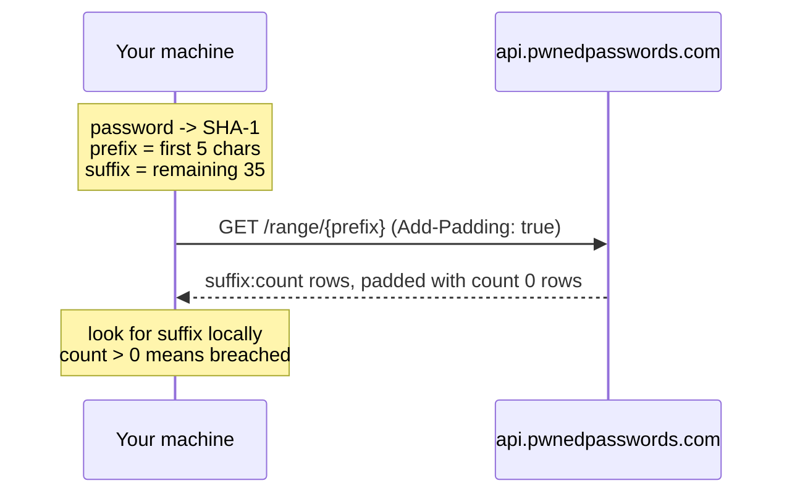

# pwned-password-check

Two small Python scripts that check passwords against the
[Have I Been Pwned](https://haveibeenpwned.com/Passwords) Pwned Passwords
dataset without sending the password, or even its full hash, anywhere.
`pwned_check.py` checks one password that you type in. `pwned_vault_check.py`
audits every Login item in your 1Password vaults and reports breached and
reused passwords.

Both use only the Python 3 standard library.

## How it works

1. The script hashes the password locally with SHA-1 and writes the hash as 40
   upper-case hex characters.
2. It splits the hash into a 5-character prefix and a 35-character suffix.
3. It sends only the prefix to the Pwned Passwords range API:
   `https://api.pwnedpasswords.com/range/{prefix}`.
4. The API replies with every known breached hash suffix that starts with that
   prefix, each with a count of how often it has been seen. A typical response
   has several hundred rows.
5. The script looks for its own suffix in that list on your machine. If it is
   there, the count says how many times the password appears in breach data.

This is a k-anonymity model. Each 5-character prefix is shared by hundreds of
different breached hashes, and by countless passwords that have never been
breached, so the service cannot tell which one you were asking about. The
plaintext never leaves your machine, and neither does the full hash, so there
is nothing useful for the service, or anyone watching the connection, to
reverse or look up.

The scripts also send the `Add-Padding: true` header. The API then adds a
random number of fake rows with a count of zero, so every response is a
similar size. Without padding, someone watching encrypted traffic could guess
the prefix from the response length. Padded rows have a count of zero, so they
can never produce a false match.



## What changed from the article's original snippet

The idea came from a short article (see [Credits](#credits)) that showed the
method in a few lines of Python. These scripts keep the same method but change
a few things:

- **Standard library only.** `urllib.request` replaces `requests`, so there is
  nothing to install with pip.
- **`getpass` instead of `input`.** The password is not echoed to the screen
  and does not end up in terminal scrollback.
- **Response padding.** The `Add-Padding: true` header is sent on every
  request, as described above.
- **Timeout and error handling.** Requests time out after 10 seconds (15 for
  the vault check), and network failures print a short message instead of a
  traceback.
- **Exit codes for scripting.** You can use the result in shell scripts
  without parsing the output.
- **A `main()` guard.** The scripts can be imported (for example by the
  tests) without prompting for anything or making a request.

## Vault audit design

`pwned_vault_check.py` is built to look at every password you have while
keeping as little of it around as possible.

- **The `op` CLI instead of a vault export.** An export writes every password
  to disk in plaintext, where it can linger in backups, sync folders or
  deleted-file recovery. The script asks the 1Password CLI for one item at a
  time through desktop app integration, so passwords only ever exist in
  memory.
- **Only hashes are kept.** Each password is SHA-1 hashed as soon as it is
  read, and the plaintext variable is cleared. The rest of the run works on
  hashes alone.
- **Prefix deduplication.** Hashes are grouped by their 5-character prefix and
  each prefix is requested once. Identical passwords therefore cost a single
  lookup, and the number of requests is at most the number of unique
  passwords.
- **Reuse report.** Because the hashes are grouped, the script can also list
  passwords shared by more than one login, even if none of them is breached.
- **Output limited to item titles.** Results show the item title and vault
  name only. Passwords, usernames and hashes are never printed.

## Setup on Ubuntu

### Install the scripts

```bash
git clone https://github.com/hitthemarks/pwned-password-check.git
cd pwned-password-check
mkdir -p ~/.local/bin
install -m 755 pwned_check.py ~/.local/bin/pwned-check
install -m 755 pwned_vault_check.py ~/.local/bin/pwned-vault-check
```

On Ubuntu, `~/.local/bin` is added to your `PATH` at login if it exists. If
`pwned-check` is not found straight away, log out and back in.

`pwned_check.py` needs nothing else. The rest of this section is only for
`pwned_vault_check.py`.

### Install the 1Password CLI

Install `op` from 1Password's own apt repository by following the official
guide: [Get started with 1Password CLI](https://developer.1password.com/docs/cli/get-started/).
Using the apt repository means the CLI is updated along with the rest of your
system.

### Use the .deb build of the 1Password app

The CLI signs in through the 1Password desktop app, and that integration
depends on the app being able to unlock with system authentication. **The
Snap and Flatpak builds of the 1Password app do not support system
authentication**, so the "Integrate with 1Password CLI" setting either does
not appear or does not work, and `op` keeps asking you to sign in manually.

If you installed 1Password from the Snap Store or Flathub, remove it and
install the .deb package instead, following
[1Password's Linux install guide](https://support.1password.com/install-linux/).

### Turn on the two settings

In the 1Password app, in this order:

1. **Settings > Security > Unlock using system authentication**
2. **Settings > Developer > Integrate with 1Password CLI**

The second option depends on the first. More detail is in
[1Password app integration](https://developer.1password.com/docs/cli/app-integration/).

Check that it works with:

```bash
op vault list
```

The 1Password app should ask you to approve access, then list your vaults.

## Usage

### Check one password

```bash
pwned-check
```

```text
Password to check (input hidden):
Seen 52,256,179 times in breaches. Change it.
```

```text
Password to check (input hidden):
Not found in the dataset.
```

| Exit code | Meaning |
| --- | --- |
| 0 | Not found |
| 1 | Found in breach data |
| 2 | No password entered |
| 3 | Lookup failed |

### Audit a 1Password account

```bash
pwned-vault-check
```

Progress goes to stderr and the report goes to stdout. Example output (all
item and vault names are made up):

```text
Reading 6 logins from 1Password...
  6/6
Checking 4 unique passwords...

2 logins use a breached password (times seen, item):

       24,230  Example Forum [Personal]
       24,230  Old Game Account [Personal]

2 passwords are shared by more than one login:

  2 logins: Example Forum [Personal], Old Game Account [Personal]
  2 logins: Demo Shop [Shared], Sample Router [Home]

Checked 5 logins (4 unique passwords). 1 had no password, 0 skipped.
```

| Exit code | Meaning |
| --- | --- |
| 0 | No breached passwords found |
| 1 | At least one breached password found |
| 3 | Error (`op` missing or failing, or a lookup failed) |

## Security notes

- **Never pass a password as a command-line argument.** Arguments are visible
  to other processes through `ps` and `/proc`, and they are saved in shell
  history. That is why `pwned-check` prompts for the password instead of
  taking it as an argument.
- **Treat the vault-check output as sensitive.** It contains no passwords, but
  a list of which accounts have weak or shared passwords is useful to an
  attacker. Do not paste it into tickets or chats, and do not save it
  somewhere that syncs.
- **1Password already does this.** Watchtower in 1Password runs the same
  Pwned Passwords check natively and also flags reused and weak passwords.
  This script is useful if you want a one-off audit from the terminal, a
  scriptable exit code, or to see exactly what is sent over the network.

## Limitations

- **Login items only.** The vault check reads items in the Login category.
  Passwords stored in other item types, such as Password, Server or Database,
  are not checked.
- **"Not found" does not mean strong.** It only means the password is not in
  the breach data. A short or predictable password can be absent from the
  dataset and still be easy to guess.
- **Network access is needed.** Both scripts call the Pwned Passwords API over
  HTTPS. They do not work offline.

## Running the tests

The tests use `unittest` from the standard library. They make no network
calls and never touch a real 1Password account: the API is mocked and a fake
`op` executable is put on `PATH`.

```bash
python3 -m unittest discover -s tests -v
```

## Credits

- The idea came from
  [Check if your password is in a breach, without ever sending your password anywhere](https://eva-georgieva.medium.com/check-if-your-password-is-in-a-breach-without-ever-sending-your-password-anywhere-bf451b6ee64b)
  by h@shtalk on Medium (22 October 2026). The explanation and code here are
  written independently.
- Breach data comes from the
  [Pwned Passwords](https://haveibeenpwned.com/Passwords) service, part of
  [Have I Been Pwned](https://haveibeenpwned.com/) by Troy Hunt. See the
  [API documentation](https://haveibeenpwned.com/API/v3#PwnedPasswords) for
  details of the range API and padding.

## Licence

Released under the MIT licence. See [LICENSE](LICENSE).
